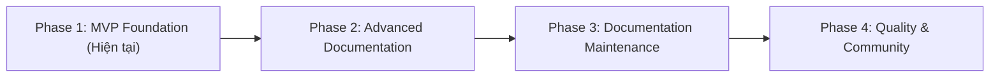

# Kế Hoạch Triển Khai: Code Documentation Agent Skill (`code-documentation-skill`)

- **Tên dự án**: `code-documentation-skill`
- **Loại dự án**: Open Source Agent Skill ([Agent Skills Specification](https://agentskills.io/specification))
- **Phiên bản đặc tả**: 1.0
- **Trạng thái**: Hoàn thành Phase 1 (MVP Foundation)
- **Thư mục dự án**: `Z:\Learn_Programming\code-documentation`

---

## 1. Tổng Quan Dự Án & Tầm Nhìn

### 1.1. Tầm nhìn (Vision)
Xây dựng một Agent Skill mã nguồn mở, độc lập nền tảng, biến AI coding agent thành một **Documentation Engineer** chuyên nghiệp và đáng tin cậy. 
Kỹ năng này giúp AI hiểu sâu cấu trúc dự án thực tế, thu thập bằng chứng từ mã nguồn, tạo tài liệu kỹ thuật chính xác, bảo trì tài liệu và phát hiện độ lệch (drift) giữa code và tài liệu.

### 1.2. Vấn đề giải quyết
- Tài liệu phần mềm thường xuyên lỗi thời do code thay đổi nhưng tài liệu không được cập nhật kịp thời.
- Lập trình viên không có đủ thời gian viết hoặc cập nhật tài liệu một cách thủ công, nhất quán.
- Các công cụ trích xuất tài liệu truyền thống chỉ lấy AST/hàm thô sơ mà không giải thích được luồng kiến trúc, nghiệp vụ hoặc các phụ thuộc hệ thống.
- AI nếu không có quy trình ràng buộc dễ bị "ảo giác" (hallucination), bịa đặt route, biến môi trường hoặc tham số không có thật.

### 1.3. Nguyên tắc cốt lõi (Core Principles)
1. **Accuracy First (Chính xác là số 1)**: Mọi thông tin kỹ thuật (API routes, tham số, env vars, cấu hình) phải có dẫn chứng (`file path`, `line number`, `symbol`). Nếu không thể xác minh, phải đánh dấu rõ là *Unknown / Cần xác nhận*.
2. **Source Code Is the Primary Source of Truth**: Mã nguồn thực tế có quyền ưu tiên cao hơn tài liệu cũ. Khi có mâu thuẫn, kiểm tra code và báo cáo độ lệch.
3. **Preserve Existing Documentation**: Kiểm tra tài liệu hiện có trước khi sửa, bảo tồn các phần do con người viết tay, cập nhật mục tiêu tối thiểu, không ghi đè bừa bãi.
4. **Minimal Changes**: Ưu tiên cập nhật vi mô đúng trọng tâm thay vì viết lại toàn bộ file.
5. **Provider Independence**: Tuân thủ chuẩn `agentskills.io`, không phụ thuộc vào bất kỳ mô hình LLM độc quyền nào.
6. **Zero External Runtime Dependencies**: Các helper scripts sử dụng 100% Python 3 Standard Library, chạy được ngay trên mọi hệ điều hành (Windows/macOS/Linux) mà không cần cài thêm gói qua pip.

---

## 2. Lộ Trình Phát Triển (Development Roadmap)



- **Phase 1: MVP Foundation (Trọng tâm hiện tại)**:
  - Khung cấu trúc repo chuẩn open-source.
  - Định nghĩa kỹ năng lõi `SKILL.md` theo đặc tả Agent Skills.
  - 4 Python helper scripts độc lập (khám phá repo, kiểm tra link, kiểm tra cấu trúc doc, phát hiện secret).
  - Tài liệu hướng dẫn mô-đun (`references/`).
  - Mẫu tài liệu (`assets/templates`).
  - Fixtures thực tế (Node.js/TypeScript & Python) và bộ unit test tự động.
- **Phase 2: Advanced Documentation**: Tạo tài liệu kiến trúc, sơ đồ Mermaid (ERD, Sequence, Flowchart), API REST/OpenAPI, sơ đồ Database/ORM.
- **Phase 3: Documentation Maintenance**: Phân tích Git diff, phát hiện lệch tài liệu (drift detection), cập nhật vi mô tự động.
- **Phase 4: Quality & Community**: Kiểm thử tương thích đa agent (Claude Code, Cursor, Antigravity, Codex), bổ sung fixture Java/Spring, hoàn thiện CI/CD.

---

## 3. Cấu Trúc Thư Mục Chi Tiết (Repository Layout)

```
code-documentation/
│
├── PLAN.md                                    # File kế hoạch tổng thể
├── README.md                                  # Hướng dẫn sử dụng & giới thiệu repo
├── LICENSE                                    # Giấy phép mã nguồn mở (MIT)
├── CONTRIBUTING.md                             # Hướng dẫn đóng góp mã nguồn
├── CHANGELOG.md                                # Nhật ký thay đổi phiên bản (v0.1.0)
├── SECURITY.md                                # Chính sách bảo mật & báo cáo lỗ hổng
├── ROADMAP.md                                 # Lộ trình phát triển chi tiết
├── .gitignore                                 # Loại trừ cache, pycache, temp files
│
├── skills/
│   └── code-documentation/
│       ├── SKILL.md                           # Điểm nhập chính của Agent Skill
│       │
│       ├── references/                        # Tài liệu hướng dẫn chuyên sâu
│       │   ├── project-discovery.md           # Heuristic nhận diện framework, language, manifest
│       │   ├── codebase-analysis.md           # Kỹ thuật duyệt code & thu thập dẫn chứng
│       │   ├── documentation-standards.md     # Chuẩn định dạng Markdown & Mermaid
│       │   ├── readme-guidelines.md           # Quy tắc tạo README chuẩn kỹ thuật
│       │   ├── documentation-validation.md    # Quy trình thẩm định chất lượng tài liệu
│       │   ├── quality-checklist.md           # Bảng kiểm tra chất lượng & phân loại lỗi
│       │   ├── architecture-documentation.md  # (Nền tảng Phase 2) Hướng dẫn tài liệu kiến trúc
│       │   ├── api-documentation.md           # (Nền tảng Phase 2) Hướng dẫn tài liệu API
│       │   ├── database-documentation.md      # (Nền tảng Phase 2) Hướng dẫn tài liệu CSDL
│       │   ├── mermaid-guidelines.md          # (Nền tảng Phase 2) Quy chuẩn cú pháp Mermaid
│       │   └── documentation-updates.md       # (Nền tảng Phase 2/3) Hướng dẫn cập nhật tài liệu
│       │
│       ├── scripts/                           # Deterministic Python CLI Helper Scripts (Stdlib)
│       │   ├── scan-project.py                # Quét cấu trúc repo, manifests, docs -> JSON
│       │   ├── check-links.py                 # Kiểm tra liên kết tương đối & heading anchors
│       │   ├── validate-docs.py               # Kiểm tra định dạng MD, tiêu đề, placeholder TODO
│       │   └── detect-secrets.py              # Quét & che giấu (redact) API keys, tokens rò rỉ
│       │
│       └── assets/                            # Templates tài liệu mẫu
│           ├── README.template.md             # Template README chuẩn
│           ├── ARCHITECTURE.template.md       # Template tài liệu Kiến trúc hệ thống
│           ├── API.template.md                # Template tài liệu API REST
│           └── DATABASE.template.md           # Template tài liệu CSDL & Thực thể
│
├── tests/                                     # Kiểm thử tự động & Fixtures mẫu
│   ├── fixtures/
│   │   ├── nodejs-typescript/                 # Fixture mẫu dự án Express/TS
│   │   │   ├── package.json
│   │   │   ├── tsconfig.json
│   │   │   ├── README.md
│   │   │   └── src/
│   │   │       ├── index.ts
│   │   │       ├── routes.ts
│   │   │       └── models.ts
│   │   │
│   │   └── python/                            # Fixture mẫu dự án FastAPI/Python
│   │       ├── pyproject.toml
│   │       ├── requirements.txt
│   │       └── app/
│   │           ├── __init__.py
│   │           ├── main.py
│   │           └── schemas.py
│   │
│   ├── test_scan_project.py                   # Test script scan-project.py
│   ├── test_check_links.py                    # Test script check-links.py
│   ├── test_validate_docs.py                  # Test script validate-docs.py
│   └── test_detect_secrets.py                 # Test script detect-secrets.py
│
└── .github/
    └── workflows/
        └── validate.yml                       # CI pipeline tự động chạy test
```

---

## 4. Chi Tiết Các Thành Phần Triển Khai (Phase 1)

### 4.1. Core Skill Definition (`skills/code-documentation/SKILL.md`)
Tuân thủ chuẩn [Agent Skills Specification](https://agentskills.io/specification).
- **Frontmatter**:
  ```yaml
  ---
  name: code-documentation
  description: >
    Analyze source code repositories and create, update,
    and validate accurate technical documentation.
    Use when developers request README generation,
    API documentation, architecture documentation,
    codebase explanation, or documentation maintenance.
  ---
  ```
- **Quy trình 8 bước (The 8-Step Workflow)**:
  1. *Understand User Intent*: Xác định mục tiêu cụ thể (viết mới README, audit link, phân tích repo).
  2. *Discover Project*: Gọi `python scan-project.py <path>` nhận JSON thông số.
  3. *Analyze Relevant Code*: Phân tích có trọng tâm các file mã nguồn liên quan.
  4. *Collect Evidence*: Ghi nhận bằng chứng cụ thể trước khi phát biểu kỹ thuật.
  5. *Create Documentation Plan*: Lập kế hoạch chỉnh sửa tối thiểu.
  6. *Generate or Update Documentation*: Áp dụng template, viết Markdown chuẩn xác.
  7. *Validate*: Chạy `check-links.py`, `validate-docs.py`, `detect-secrets.py`.
  8. *Report*: Xuất báo cáo tổng kết gồm số file đã quét, tài liệu tạo/sửa, và cảnh báo (nếu có).

### 4.2. Helper Scripts (Python 3 Standard Library - Không cần `pip install`)
| Tên Script | Mục tiêu & Hành vi | Đầu ra (Output) | Mã thoát (Exit code) |
| :--- | :--- | :--- | :--- |
| `scan-project.py` | Quét cây thư mục, bỏ qua các thư mục ignore (`node_modules`, `.git`, `.venv`, `dist`, `target`), phát hiện manifest (`package.json`, `pyproject.toml`, `Cargo.toml`, `go.mod`, `pom.xml`,...) | Chuỗi JSON có cấu trúc | `0`: Thành công<br>`1`: Đường dẫn không hợp lệ |
| `check-links.py` | Trích xuất toàn bộ link tương đối và heading anchor `#anchor-name` trong file Markdown, kiểm tra file đích có tồn tại hay không. | Danh sách link hỏng kèm vị trí file & dòng | `0`: Mọi link hợp lệ<br>`1`: Có link hỏng |
| `validate-docs.py` | Thẩm định cấu trúc tài liệu, kiểm tra tiêu đề H1, phát hiện file rỗng hoặc chứa placeholder chưa hoàn thiện (`TODO`, `FIXME`, `<INSERT_HERE>`). | Báo cáo JSON phân loại lỗi: Critical, Warning, Info | `0`: Hợp lệ<br>`1`: Có lỗi Critical |
| `detect-secrets.py` | Quét regex phát hiện API keys, private keys, bearer tokens, DB credentials. Tự động che mờ (redact) giá trị nhạy cảm khi hiển thị. | Danh sách cảnh báo file, dòng và loại secret | `0`: An toàn<br>`1`: Phát hiện secret |

### 4.3. Tài Liệu Hướng Dẫn Kỹ Thuật (`references/`)
- `project-discovery.md`: Hướng dẫn cách phân loại dự án dựa trên manifest, cấu trúc thư mục đặc trưng của từng ngôn ngữ/hệ sinh thái.
- `codebase-analysis.md`: Phương pháp đọc code gia tăng (incremental reading), cách map router với controller, cách trích xuất schema database/ORM.
- `documentation-standards.md`: Chuẩn cú pháp Markdown, phong cách viết chuyên nghiệp, cấu trúc bảng và code block.
- `readme-guidelines.md`: Tiêu chuẩn chi tiết cho từng phần của README (Overview, Stack, Quickstart, Env Config, Commands).
- `documentation-validation.md`: Quy trình phối hợp giữa các script thẩm định và đánh giá ngữ nghĩa.
- `quality-checklist.md`: Phân hạng mức độ nghiêm trọng từ Critical đến Informational để phân loại lỗi trong tài liệu.

### 4.4. Fixtures & Kiểm Thử Tự Động (`tests/`)
1. **Node.js/TypeScript Fixture**:
   - `package.json` định nghĩa Express, TypeScript, ts-node.
   - `src/index.ts`, `src/routes.ts`, `src/models.ts` thể hiện REST API rõ ràng.
2. **Python Fixture**:
   - `pyproject.toml` và `requirements.txt` định nghĩa FastAPI, Uvicorn, Pydantic.
   - `app/main.py` và `app/schemas.py` thể hiện API endpoints.
3. **Unit Tests Suite**:
   - `test_scan_project.py`: Đảm bảo script scan nhận diện chính xác các fixture mẫu, loại trừ đúng các thư mục ignore.
   - `test_check_links.py`: Kiểm tra khả năng phát hiện đúng liên kết hợp lệ, link gãy và anchor slug.
   - `test_validate_docs.py`: Kiểm thử việc bắt các file rỗng hoặc chứa placeholder `TODO`.
   - `test_detect_secrets.py`: Kiểm thử việc phát hiện mẫu secret và kiểm tra xem output có bị lộ khóa gốc hay không.

---

## 5. Quy Trình Xác Minh & Nghiệm Thu (Verification Plan)

### 5.1. Chạy Kiểm Thử Đơn Vị (Automated Unit Tests)
```powershell
python -m unittest discover -s tests -p "test_*.py" -v
```
Hoặc:
```powershell
pytest tests/ -v
```
*Tiêu chí đạt*: 100% test case pass, không có lỗi hoặc cảnh báo crash.

### 5.2. Chạy Thử Nghiệm Tích Hợp (CLI Verification)
1. **Quét fixture Node.js**:
   ```powershell
   python skills/code-documentation/scripts/scan-project.py tests/fixtures/nodejs-typescript
   ```
2. **Quét fixture Python**:
   ```powershell
   python skills/code-documentation/scripts/scan-project.py tests/fixtures/python
   ```
3. **Tự thẩm định tài liệu của chính dự án (Dogfooding)**:
   ```powershell
   python skills/code-documentation/scripts/check-links.py .
   python skills/code-documentation/scripts/validate-docs.py .
   python skills/code-documentation/scripts/detect-secrets.py .
   ```
   *Tiêu chí đạt*: Bộ tài liệu của chính repository này vượt qua toàn bộ các bước kiểm tra link, cú pháp và phát hiện secret (mã thoát `0`).

---

## 6. Tiêu Chí Hoàn Thành Phase 1 (Acceptance Criteria)

- [x] Cấu trúc thư mục dự án hoàn chỉnh đúng đặc tả kỹ thuật.
- [x] File `skills/code-documentation/SKILL.md` hợp lệ theo chuẩn `agentskills.io`.
- [x] 4 helper scripts (`scan-project.py`, `check-links.py`, `validate-docs.py`, `detect-secrets.py`) hoạt động độc lập và ổn định bằng Python Standard Library.
- [x] Toàn bộ unit tests trong `tests/` pass 100%.
- [x] Hai bộ fixture `nodejs-typescript` và `python` hoạt động đúng kỳ vọng khi scan.
- [x] Các tài liệu open-source căn bản (`README.md`, `LICENSE`, `CONTRIBUTING.md`, `CHANGELOG.md`, `SECURITY.md`, `ROADMAP.md`) được hoàn thiện đầy đủ.
- [x] Bộ tài liệu mẫu (`assets/*.template.md`) và hướng dẫn kỹ thuật (`references/*.md`) đã sẵn sàng.

