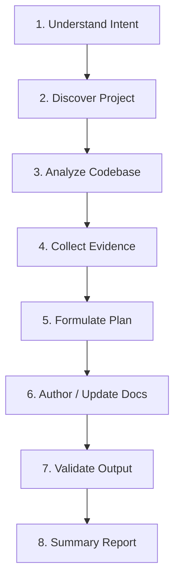

# Code Documentation Agent Skill (`code-documentation`)

[](https://agentskills.io/specification)
[](LICENSE)
[](#requirements)
[](#testing)

An open-source, vendor-neutral agent skill conforming to the [Agent Skills Specification](https://agentskills.io/specification). This skill equips AI coding assistants and autonomous engineering agents with systematic capabilities to inspect source code, generate precise technical documentation, validate markdown structure and relative links, and detect documentation drift.

---

## Table of Contents

- [Overview](#overview)
- [Core Philosophy](#core-philosophy)
- [Repository Structure](#repository-structure)
- [Capabilities and Workflow](#capabilities-and-workflow)
- [Helper Scripts (Standard Library)](#helper-scripts-standard-library)
  - [scan-project.py](#scan-projectpy)
  - [check-links.py](#check-linkspy)
  - [validate-docs.py](#validate-docspy)
  - [detect-secrets.py](#detect-secretspy)
- [Installation and Integration](#installation-and-integration)
  - [Antigravity CLI](#antigravity-cli)
  - [Cursor / Claude Code / Custom Agents](#cursor--claude-code--custom-agents)
- [Requirements](#requirements)
- [Testing](#testing)
- [Contributing](#contributing)
- [License](#license)

---

## Overview

Software documentation is notorious for falling out of sync with rapidly evolving codebases. Traditional static documentation generators extract signatures but miss architecture context, deployment procedures, and business logic. Conversely, unconstrained AI models frequently hallucinate API endpoints, environment variables, or obsolete library methods.

`code-documentation` bridges this gap by imposing an evidence-based, 8-step documentation workflow combined with zero-dependency deterministic validation scripts.

---

## Core Philosophy

1. **Accuracy First**: Every API route, configuration parameter, model entity, and prerequisite stated in documentation must be backed by concrete source code evidence (file path and line number).
2. **Code is the Ground Truth**: When documentation conflicts with code behavior, code takes precedence and the discrepancy is flagged.
3. **Preserve Human Effort**: Never blindly overwrite custom hand-crafted sections or architecture rationales; perform surgical, targeted updates.
4. **Zero Runtime Dependencies**: All helper scripts rely strictly on Python 3's standard library for universal compatibility across Linux, macOS, and Windows.
5. **Vendor Independence**: Operates seamlessly across any AI agent supporting system prompts or tool execution.

---

## Repository Structure

```text
code-documentation/
├── PLAN.md                                    # Comprehensive engineering plan
├── README.md                                  # Repository documentation
├── LICENSE                                    # MIT License
├── CONTRIBUTING.md                             # Contribution guidelines
├── CHANGELOG.md                                # Release history
├── SECURITY.md                                # Security policy
├── ROADMAP.md                                 # Roadmap and milestones
├── .gitignore                                 # Git ignore definitions
│
├── skills/
│   └── code-documentation/
│       ├── SKILL.md                           # Main agent skill definition (agentskills.io)
│       │
│       ├── references/                        # Technical guides for agents and engineers
│       │   ├── project-discovery.md           # Framework and project heuristics
│       │   ├── codebase-analysis.md           # Incremental codebase reading techniques
│       │   ├── documentation-standards.md     # Markdown and style specifications
│       │   ├── readme-guidelines.md           # Standards for production READMEs
│       │   ├── documentation-validation.md    # Multi-stage validation procedures
│       │   ├── quality-checklist.md           # Severity ranking and quality metrics
│       │   ├── architecture-documentation.md  # Architectural overview guidelines
│       │   ├── api-documentation.md           # REST and OpenAPI documentation standards
│       │   ├── database-documentation.md      # Schemas and entity-relationship docs
│       │   ├── mermaid-guidelines.md          # Diagramming best practices and rules
│       │   └── documentation-updates.md       # Drift detection and update workflows
│       │
│       ├── scripts/                           # Deterministic CLI utilities (Python 3 stdlib)
│       │   ├── scan-project.py                # Repo tree, manifests, and stack scanner
│       │   ├── check-links.py                 # Relative links and anchor validator
│       │   ├── validate-docs.py               # Document structure and placeholder linter
│       │   └── detect-secrets.py              # Secret leak scanner and redactor
│       │
│       └── assets/                            # Documentation blueprints and templates
│           ├── README.template.md             # Standard project README template
│           ├── ARCHITECTURE.template.md       # Architecture blueprint template
│           ├── API.template.md                # REST API reference template
│           └── DATABASE.template.md           # Database model template
│
├── tests/                                     # Automated test suite and test fixtures
│   ├── fixtures/                              # Sample codebases for testing
│   │   ├── nodejs-typescript/                 # Sample TypeScript/Express service
│   │   └── python/                            # Sample Python/FastAPI service
│   ├── test_scan_project.py                   # Tests for scan-project.py
│   ├── test_check_links.py                    # Tests for check-links.py
│   ├── test_validate_docs.py                  # Tests for validate-docs.py
│   └── test_detect_secrets.py                 # Tests for detect-secrets.py
│
└── .github/
    └── workflows/
        └── validate.yml                       # CI pipeline for automated testing
```

---

## Capabilities and Workflow

The skill enforces an **8-Step Documentation Workflow**:



1. **Understand Intent**: Clarify target audience, document type, and scope.
2. **Discover Project**: Execute `scan-project.py` to identify language, manifest, entry points, and existing documentation.
3. **Analyze Codebase**: Traverse routes, configurations, models, and scripts methodically.
4. **Collect Evidence**: Note file paths, line references, and symbols before drafting assertions.
5. **Formulate Plan**: Determine whether creating from scratch or performing non-destructive edits.
6. **Author / Update Docs**: Use templates in `assets/` and follow standards in `references/`.
7. **Validate Output**: Execute `validate-docs.py`, `check-links.py`, and `detect-secrets.py`.
8. **Summary Report**: Output changes, validated metrics, and actionable notes.

---

## Helper Scripts (Standard Library)

All scripts run without external package installation using standard Python 3.

### scan-project.py

Scans a project directory to discover project manifests (`package.json`, `pyproject.toml`, `Cargo.toml`, `go.mod`, etc.), framework technologies, directory trees, and existing documentation files while respecting ignore patterns.

```bash
# Output formatted JSON analysis
python skills/code-documentation/scripts/scan-project.py /path/to/project

# Pretty text summary
python skills/code-documentation/scripts/scan-project.py /path/to/project --format text
```

### check-links.py

Scans markdown documents for broken relative file paths and heading anchor references (`#section-heading`), slugifying headings according to GitHub markdown standards.

```bash
# Verify all markdown links in a directory
python skills/code-documentation/scripts/check-links.py /path/to/project

# Verify a single file
python skills/code-documentation/scripts/check-links.py /path/to/project/README.md
```

### validate-docs.py

Validates document formatting integrity, ensuring top-level headings exist, unclosed code fences are flagged, and leftover template placeholders (`TODO`, `FIXME`, `<INSERT_HERE>`) are reported.

```bash
python skills/code-documentation/scripts/validate-docs.py /path/to/project
```

### detect-secrets.py

Scans documentation for accidentally committed API keys, private keys, bearer tokens, and connection strings. Automatically redacts detected sensitive strings in console outputs.

```bash
python skills/code-documentation/scripts/detect-secrets.py /path/to/project
```

---

## Installation and Integration

### Antigravity CLI

Place this repository or symlink into your skills directory:

```bash
# Global installation
cp -r skills/code-documentation ~/.gemini/skills/

# Or workspace-specific installation
cp -r skills/code-documentation .agents/skills/
```

### Cursor / Claude Code / Custom Agents

Reference `skills/code-documentation/SKILL.md` within your system prompt, `.cursorrules`, or `CLAUDE.md`.

---

## Requirements

- Python 3.10 or higher
- Any modern operating system (Linux, macOS, Windows)

---

## Testing

Run the automated test suite with Python's built-in `unittest` runner:

```bash
python -m unittest discover -s tests -p "test_*.py" -v
```

---

## Contributing

Contributions, bug reports, and enhancements are welcome! Please review [CONTRIBUTING.md](CONTRIBUTING.md) for details on code style, testing requirements, and submission processes.

---

## License

This project is licensed under the [MIT License](LICENSE).
