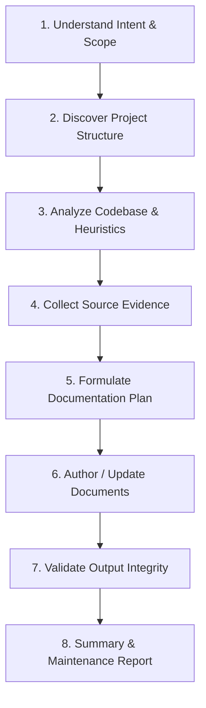

# Code Documentation Agent Skill (`code-documentation`)

[](https://agentskills.io/specification)
[](LICENSE)
[](#requirements)
[](#testing)
[-blue.svg)](#helper-scripts-standard-library)

An open-source, vendor-neutral agent skill conforming to the [Agent Skills Specification](https://agentskills.io/specification). This skill equips AI coding assistants (Google Antigravity, Cursor, Claude Code, Windsurf, GitHub Copilot) and human engineering teams with systematic workflows and zero-dependency CLI utilities to inspect codebases, generate verified technical documentation, validate markdown structure and relative links, and prevent documentation drift.

---

## Table of Contents

- [Overview](#overview)
- [Core Philosophy](#core-philosophy)
- [The 8-Step Documentation Workflow](#the-8-step-documentation-workflow)
- [Developer CLI Usage (Zero Dependencies)](#developer-cli-usage-zero-dependencies)
  - [1. scan-project.py](#1-scan-projectpy)
  - [2. check-links.py](#2-check-linkspy)
  - [3. validate-docs.py](#3-validate-docspy)
  - [4. detect-secrets.py](#4-detect-secretspy)
- [AI Agent Integration Guide](#ai-agent-integration-guide)
  - [Google Antigravity](#google-antigravity)
  - [Cursor IDE](#cursor-ide)
  - [Claude Code](#claude-code)
  - [Windsurf & GitHub Copilot](#windsurf--github-copilot)
  - [Example Prompts for AI Agents](#example-prompts-for-ai-agents)
- [Documentation Template Library](#documentation-template-library)
- [CI/CD Pipeline Integration](#cicd-pipeline-integration)
- [Requirements](#requirements)
- [Testing](#testing)
- [Contributing](#contributing)
- [License](#license)

---

## Overview

Software documentation notoriously lags behind rapidly evolving codebases. Traditional static documentation tools extract method signatures but lack architectural insight, business logic context, and operational deployment steps. Conversely, unconstrained AI coding assistants frequently hallucinate fictitious API routes, non-existent configuration variables, or deprecated functions.

`code-documentation` solves both challenges:
1. **Evidence-Based Generation**: Enforces that every documented assertion (route, parameter, configuration key, model schema) cites verified source code evidence (`file_path` and line numbers).
2. **Deterministic Verification**: Provides four independent Python standard library scripts that validate project discovery, markdown link integrity, structural health, and credential leakage without installing third-party packages.

---

## Core Philosophy

1. **Accuracy First**: Every API route, configuration parameter, model entity, and prerequisite stated in documentation must be backed by concrete source code evidence.
2. **Code is Ground Truth**: When existing documentation conflicts with actual code behavior, code takes precedence and documentation drift must be resolved.
3. **Preserve Human Effort**: Never blindly overwrite custom hand-crafted sections or architecture rationales; perform surgical, non-destructive updates.
4. **Zero Runtime Dependencies**: All helper scripts rely strictly on Python 3's built-in standard library for instant execution across Linux, macOS, and Windows.
5. **Universal Agent Compatibility**: Fully adheres to the `agentskills.io` standard, compatible with any LLM harness capable of system prompt ingestion or tool execution.

---

## The 8-Step Documentation Workflow

The skill organizes documentation engineering into an 8-step iterative cycle:



1. **Understand Intent**: Clarify target audience (end-user, developer, DevOps), document scope (README, API, Architecture, Database), and language preferences.
2. **Discover Project**: Run `scan-project.py` to identify languages, package managers, framework dependencies, and entry points.
3. **Analyze Codebase**: Traverse routes, configurations, models, and scripts methodically following `references/codebase-analysis.md`.
4. **Collect Evidence**: Note file paths, line references, and symbols before drafting assertions.
5. **Formulate Plan**: Determine whether creating from scratch or performing non-destructive edits to existing files.
6. **Author / Update Docs**: Adapt blueprints from `assets/` and apply styling rules from `references/`.
7. **Validate Output**: Execute `validate-docs.py`, `check-links.py`, and `detect-secrets.py` to catch broken links, unclosed code fences, or leaked keys.
8. **Summary Report**: Output an executive summary of changes, verified links, and any unresolved drift items.

---

## Developer CLI Usage (Zero Dependencies)

All scripts run out-of-the-box using the standard Python 3.10+ installation. No `pip install` required!

### 1. scan-project.py

Discovers project manifests (`package.json`, `pyproject.toml`, `Cargo.toml`, `go.mod`, `pom.xml`, etc.), framework technologies (Express, FastAPI, Django, React, Vue, NestJS, Spring, etc.), directory trees, and existing documentation.

```bash
# Pretty text summary
python skills/code-documentation/scripts/scan-project.py /path/to/project --format text

# Formatted JSON output (ideal for piping into AI tools or scripts)
python skills/code-documentation/scripts/scan-project.py /path/to/project --format json

# Export scan results directly to a file
python skills/code-documentation/scripts/scan-project.py /path/to/project -o scan-results.json

# Exclude specific directories
python skills/code-documentation/scripts/scan-project.py /path/to/project --ignore "temp,build_cache"
```

**Sample Output:**
```text
=== Project Analysis: sample-service ===
Root Path: /workspace/sample-service
Primary Language: TypeScript
Frameworks: Express, Pydantic
Total Files: 42 (in 12 directories)

Manifest Files:
  - package.json
  - tsconfig.json

Detected Entry Points:
  - src/index.ts

Documentation Files:
  - README.md
  - CONTRIBUTING.md
```

---

### 2. check-links.py

Scans markdown documents for broken relative file paths and heading anchor references (`#section-heading`), generating GitHub-compatible slug anchors.

```bash
# Verify all markdown links across a project
python skills/code-documentation/scripts/check-links.py /path/to/project

# Check a single markdown file
python skills/code-documentation/scripts/check-links.py /path/to/project/README.md

# Output JSON report
python skills/code-documentation/scripts/check-links.py /path/to/project --format json

# Quiet mode (only outputs if broken links exist, perfect for CI/CD)
python skills/code-documentation/scripts/check-links.py /path/to/project --quiet
```

**Exit Codes:**
- `0`: All relative links and heading anchors are valid.
- `1`: One or more broken links detected.

---

### 3. validate-docs.py

Validates document formatting integrity:
- Enforces top-level `# Title` (H1) heading existence.
- Flags unclosed markdown code fences (```).
- Detects forgotten template placeholders (`TODO`, `FIXME`, `<INSERT_HERE>`, `TBD`).

```bash
# Validate all markdown files in a project
python skills/code-documentation/scripts/validate-docs.py /path/to/project

# Validate a specific file
python skills/code-documentation/scripts/validate-docs.py /path/to/project/README.md

# Output JSON report
python skills/code-documentation/scripts/validate-docs.py /path/to/project --format json
```

**Exit Codes:**
- `0`: All documents passed formatting and placeholder validation.
- `1`: Structural errors or leftover placeholders detected.

---

### 4. detect-secrets.py

Scans documentation for accidentally committed API keys, private keys, bearer tokens, AWS credentials, and database connection strings. Detected secrets are automatically redacted in the output to prevent accidental exposure.

```bash
# Scan all documentation in a project
python skills/code-documentation/scripts/detect-secrets.py /path/to/project

# Scan a single documentation file
python skills/code-documentation/scripts/detect-secrets.py /path/to/project/docs/api.md

# Output JSON report
python skills/code-documentation/scripts/detect-secrets.py /path/to/project --format json
```

**Exit Codes:**
- `0`: Clean. No exposed credentials detected.
- `1`: Exposed credentials or secret patterns detected.

---

## AI Agent Integration Guide

### Google Antigravity

To register this skill with Google Antigravity:

1. **Global Installation**:
   Copy the `skills/code-documentation` folder into your global Antigravity skills directory:
   ```bash
   # Windows (PowerShell)
   Copy-Item -Recurse skills/code-documentation $HOME\.gemini\antigravity\skills\

   # Linux / macOS
   cp -r skills/code-documentation ~/.gemini/antigravity/skills/
   ```

2. **Workspace-Specific Installation**:
   Place the skill directly into your project's `.gemini/skills/` directory:
   ```bash
   mkdir -p .gemini/skills
   cp -r /path/to/code-documentation/skills/code-documentation .gemini/skills/
   ```

Once installed, Antigravity automatically activates `code-documentation` when you request documentation tasks.

---

### Cursor IDE

Create a project rule at `.cursor/rules/code-documentation.mdc`:

```markdown
---
description: Code documentation generation and maintenance standard
globs: ["**/*.md", "docs/**"]
---

When authoring or updating technical documentation:
1. Always follow the 8-step workflow defined in `skills/code-documentation/SKILL.md`.
2. Inspect source code first using `skills/code-documentation/scripts/scan-project.py`.
3. Back all documented routes, parameters, and configurations with file and line evidence.
4. Validate outputs with `validate-docs.py`, `check-links.py`, and `detect-secrets.py`.
```

---

### Claude Code

Add the following directive to your project's `CLAUDE.md`:

```markdown
# Documentation Guidelines
When writing or maintaining documentation:
- Consult `skills/code-documentation/SKILL.md` for standards and workflows.
- Use templates from `skills/code-documentation/assets/`.
- Run `python skills/code-documentation/scripts/validate-docs.py .` before finalizing.
- Run `python skills/code-documentation/scripts/check-links.py .` to ensure zero broken links.
- Run `python skills/code-documentation/scripts/detect-secrets.py .` to prevent credential leaks.
```

---

### Windsurf & GitHub Copilot

Add instructions to `.windsurfrules` or `.github/copilot-instructions.md`:

```markdown
Follow the evidence-based documentation standards in `skills/code-documentation/SKILL.md`. Always run `validate-docs.py` and `check-links.py` to ensure all links and markdown syntax are valid.
```

---

### Example Prompts for AI Agents

- **Generate Complete README**:
  > "Sử dụng skill code-documentation để quét toàn bộ codebase và viết một file README.md chuẩn sản xuất từ template assets/README.template.md."
- **Generate REST API Documentation**:
  > "Hãy phân tích các endpoint trong thư mục `src/routes/` và tạo tài liệu `docs/API.md` với đầy đủ method, URL, headers, request body mẫu và response codes."
- **Detect Documentation Drift**:
  > "So sánh các routes hiện tại trong code với file `README.md` và `docs/API.md`. Liệt kê các điểm bị lệch và cập nhật tài liệu chính xác theo code mới nhất."
- **Security & Link Audit**:
  > "Hãy chạy `check-links.py`, `validate-docs.py`, và `detect-secrets.py` trên toàn bộ tài liệu trong repo này và sửa tất cả các lỗi được phát hiện."

---

## Documentation Template Library

The skill includes production-ready blueprints in `skills/code-documentation/assets/`:

| Template File | Target Use Case | Key Sections Included |
| :--- | :--- | :--- |
| [`README.template.md`](skills/code-documentation/assets/README.template.md) | Root repository README | Badges, Overview, Quick Start, Prerequisites, CLI Usage, Configuration Env, Testing, Contributing, License |
| [`ARCHITECTURE.template.md`](skills/code-documentation/assets/ARCHITECTURE.template.md) | High-level system design | Architecture Diagram (Mermaid), Component Breakdown, Data Flow, Security Boundary, Technology Decisions |
| [`API.template.md`](skills/code-documentation/assets/API.template.md) | REST / HTTP API reference | Authentication, Rate Limits, Error Codes, Endpoints (Headers, Query, Body, Responses) |
| [`DATABASE.template.md`](skills/code-documentation/assets/DATABASE.template.md) | Data layer & ORM schema | ERD Diagram (Mermaid), Table / Collection Schemas, Indexes, Migration Guide, Backup Procedures |

---

## CI/CD Pipeline Integration

Integrate automated documentation checks directly into your GitHub Actions workflow (`.github/workflows/validate.yml`):

```yaml
name: Documentation & Quality Checks

on:
  push:
    branches: [main]
  pull_request:
    branches: [main]

jobs:
  validate-docs:
    runs-on: ubuntu-latest
    steps:
      - name: Checkout Code
        uses: actions/checkout@v4

      - name: Set up Python
        uses: actions/setup-python@v5
        with:
          python-version: "3.11"

      - name: Run Unit Tests
        run: |
          python -m unittest discover -s tests -p "test_*.py" -v

      - name: Validate Markdown Structure
        run: |
          python skills/code-documentation/scripts/validate-docs.py .

      - name: Check Relative Links & Anchors
        run: |
          python skills/code-documentation/scripts/check-links.py .

      - name: Scan for Leaked Credentials
        run: |
          python skills/code-documentation/scripts/detect-secrets.py .
```

---

## Requirements

- **Python**: Version 3.10 or higher.
- **Operating System**: Linux, macOS, or Windows (cross-platform path support).
- **External Dependencies**: **None** (100% Python Standard Library).

---

## Testing

Run the comprehensive unit test suite covering all helper scripts and fixture environments:

```bash
python -m unittest discover -s tests -p "test_*.py" -v
```

**Test Coverage Summary:**
- `test_scan_project.py`: Project manifest detection, stack resolution, ignore handling.
- `test_check_links.py`: Relative file resolution, heading slugification, internal anchors, code fence exclusion.
- `test_validate_docs.py`: Document structure, H1 presence, unclosed code fences, placeholder detection.
- `test_detect_secrets.py`: High-entropy regex patterns, private keys, AWS/GitHub token detection, redaction.

---

## Contributing

Contributions, bug reports, and enhancements are welcome! Please review [CONTRIBUTING.md](CONTRIBUTING.md) for details on code style, testing requirements, and submission processes.

---

## License

This project is licensed under the [MIT License](LICENSE).
