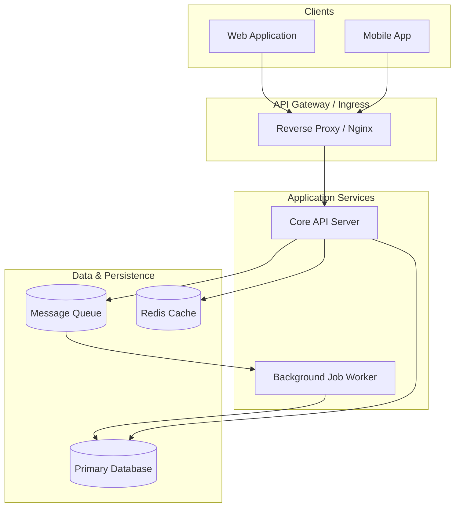
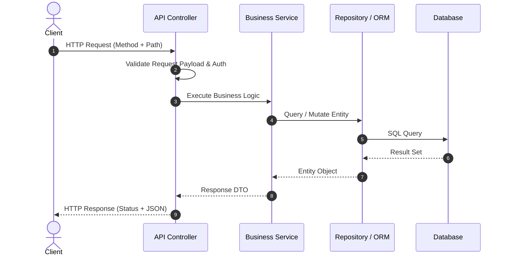

# Architecture & System Design: <PROJECT_NAME>

---

## 1. System Overview

<HIGH_LEVEL_DESCRIPTION_OF_THE_SYSTEM_PURPOSE_AND_GOALS>

---

## 2. High-Level Architecture Diagram

---

## 3. Component Responsibilities

| Component | Responsibility | Technologies |
| :--- | :--- | :--- |
| **API Server** | Handles client requests, authentication, and validation | <TECH_1> |
| **Worker** | Processes asynchronous background tasks | <TECH_2> |
| **Primary Database**| Persistent transactional storage | <TECH_3> |
| **Cache** | In-memory caching and session management | <TECH_4> |

---

## 4. Request Lifecycle & Data Flow

---

## 5. Architectural Decision Records (ADRs)

### ADR-001: <DECISION_TITLE>
- **Status**: Accepted
- **Context**: <WHY_WAS_A_DECISION_NEEDED>
- **Decision**: <WHAT_WAS_CHOSEN>
- **Consequences**: <BENEFITS_AND_TRADEOFFS>

---

## 6. Cross-Cutting Concerns

### Authentication & Authorization
<EXPLANATION_OF_AUTH_MECHANISMS>

### Error Handling & Logging
<EXPLANATION_OF_ERROR_AND_LOGGING_PATTERNS>

### Scalability & Caching
<EXPLANATION_OF_CACHING_STRATEGY>
