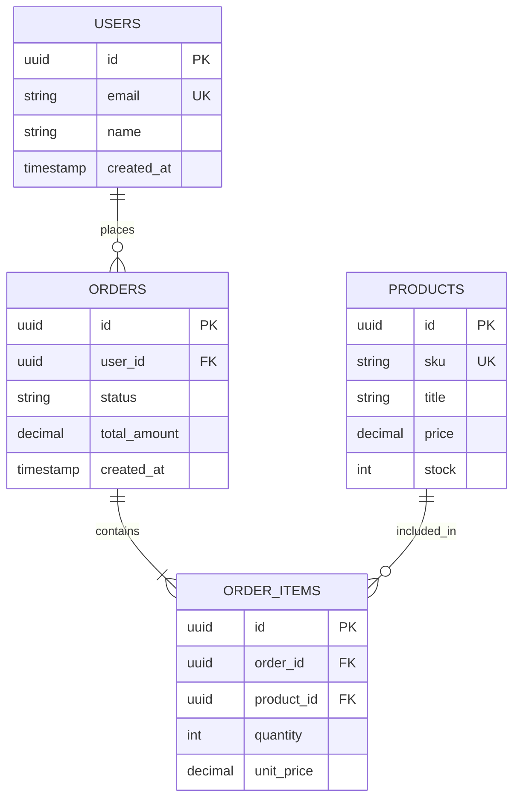

# Database Architecture & Schemas: <PROJECT_NAME>

---

## 1. Overview

- **Database Engine**: <DATABASE_ENGINE> (e.g., PostgreSQL 15, MySQL 8, MongoDB 6)
- **ORM / Query Layer**: <ORM_FRAMEWORK> (e.g., Prisma, SQLAlchemy, TypeORM)
- **Migrations Directory**: `<MIGRATION_PATH>`

---

## 2. Entity-Relationship Diagram (ERD)



---

## 3. Table Definitions & Schemas

### `users`

Stores primary user accounts and credentials.

| Column | Type | Constraints | Description |
| :--- | :--- | :--- | :--- |
| `id` | `UUID` | Primary Key, Default `gen_random_uuid()` | Unique record identifier |
| `email` | `VARCHAR(255)` | Unique, Not Null | Account email address |
| `name` | `VARCHAR(100)` | Not Null | Display name |
| `created_at` | `TIMESTAMP WITH TIME ZONE` | Default `NOW()` | Account creation time |

---

## 4. Indexes & Performance

| Table | Index Name | Columns | Type | Purpose |
| :--- | :--- | :--- | :--- | :--- |
| `users` | `idx_users_email` | `email` | Unique B-Tree | Fast user lookup by email |
| `orders` | `idx_orders_user_id`| `user_id` | B-Tree | Optimizes foreign key queries |

---

## 5. Migration Runbook

### Apply Migrations
```bash
<MIGRATION_UP_COMMAND>
```

### Rollback Migration
```bash
<MIGRATION_DOWN_COMMAND>
```
