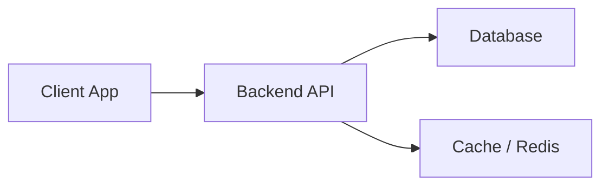

# <PROJECT_NAME>

[](#)
[](LICENSE)
[](#)

<ONE_LINE_DESCRIPTION_OF_THE_PROJECT>

---

## Table of Contents

- [Overview](#overview)
- [Key Features](#key-features)
- [Architecture & Tech Stack](#architecture--tech-stack)
- [Prerequisites](#prerequisites)
- [Quickstart](#quickstart)
- [Configuration](#configuration)
- [Available Scripts](#available-scripts)
- [Testing](#testing)
- [Contributing](#contributing)
- [License](#license)

---

## Overview

<CONCISE_PARAGRAPH_EXPLAINING_THE_PROBLEM_AND_SOLUTION>

---

## Key Features

- **Feature 1**: <DESCRIPTION>
- **Feature 2**: <DESCRIPTION>
- **Feature 3**: <DESCRIPTION>
- **Feature 4**: <DESCRIPTION>

---

## Architecture & Tech Stack



- **Runtime / Language**: <LANGUAGE_AND_VERSION>
- **Framework**: <FRAMEWORK_NAME>
- **Database**: <DATABASE_ENGINE>
- **Testing**: <TEST_FRAMEWORK>

---

## Prerequisites

Before starting, ensure you have the following installed:
- <PREREQUISITE_1> (e.g., Node.js >= 18.0.0 or Python >= 3.10)
- <PREREQUISITE_2> (e.g., Docker or PostgreSQL)

---

## Quickstart

### 1. Clone the repository
```bash
git clone <REPOSITORY_URL>
cd <PROJECT_DIRECTORY>
```

### 2. Install dependencies
```bash
<DEPENDENCY_INSTALL_COMMAND>
```

### 3. Configure environment
```bash
cp .env.example .env
# Edit .env with your local configuration
```

### 4. Run database migrations (if applicable)
```bash
<MIGRATION_COMMAND>
```

### 5. Start the development server
```bash
<DEV_SERVER_COMMAND>
```

---

## Configuration

The application is configured using environment variables:

| Variable | Type | Default | Required | Description |
| :--- | :--- | :--- | :--- | :--- |
| `PORT` | Number | `8080` | No | HTTP server port |
| `DATABASE_URL` | String | - | Yes | Connection string for database |
| `NODE_ENV` | String | `development`| No | Runtime environment (`development`, `production`) |

---

## Available Scripts

| Command | Purpose |
| :--- | :--- |
| `<COMMAND_DEV>` | Starts local development server with hot-reload |
| `<COMMAND_BUILD>` | Compiles code for production distribution |
| `<COMMAND_START>` | Runs production build |
| `<COMMAND_TEST>` | Executes unit and integration test suite |
| `<COMMAND_LINT>` | Runs static code analysis and format checks |

---

## Testing

Run the test suite:
```bash
<TEST_COMMAND>
```

---

## Contributing

Please review [CONTRIBUTING.md](CONTRIBUTING.md) for details on code style, branch conventions, and testing guidelines.

---

## License

This project is licensed under the [MIT License](LICENSE).
