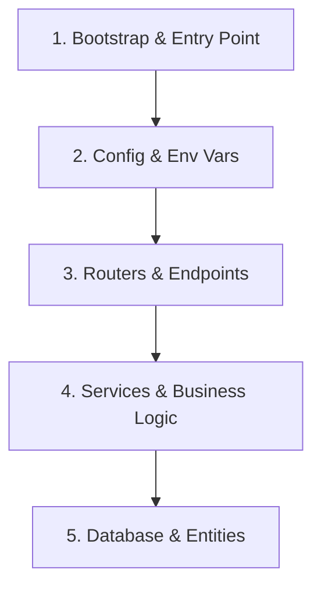

# Codebase Analysis & Evidence Gathering Guide

## Overview

Accurate documentation demands grounded evidence. An agent must never guess how a system is structured or extrapolate parameters from imagination. This guide provides systematic strategies for navigating source code and gathering verifiable evidence.

---

## 1. Incremental Code Reading Strategy

Do not attempt to read an entire codebase at once. Instead, follow a top-down, incremental analysis loop:

### Stage 1: Entry Point & Lifecycle
Inspect the bootstrap file (e.g. `src/index.ts`, `app/main.py`):
- What port does it listen on?
- What global middleware is registered (CORS, body parser, rate limiters, auth)?
- How is database connectivity established?

### Stage 2: Configuration & Environment Variables
Locate the settings module or `.env.example`:
- Extract mandatory vs. optional variables.
- Note default fallback values directly from code (e.g., `process.env.PORT || 3000`).
- Document requirements without exposing secrets.

### Stage 3: Routes & Controllers
Map HTTP methods and paths to controller functions:
- Identify path parameters: `/users/:id` or `/users/{user_id}`.
- Identify query parameters and query filters.
- Identify request payload schemas (Zod, Pydantic, Joi, class-validator).

### Stage 4: Data Models & Persistence
Examine the ORM/ODM layer:
- Prisma: `prisma/schema.prisma`
- TypeORM / MikroORM: `@Entity()`, `@Column()`
- SQLAlchemy: `Base`, `Column`, `relationship`
- Mongoose: `new Schema({...})`
- Pydantic: `BaseModel`

---

## 2. Evidence Tracking Table

Before generating or updating documentation, compile an internal evidence register:

| Domain | Technical Fact | Evidence Location | Verified Syntax |
| :--- | :--- | :--- | :--- |
| Environment | Port defaults to 8080 | `src/config.ts:15` | `const PORT = process.env.PORT || 8080` |
| Route | `POST /api/v1/auth/login` | `src/routes/auth.ts:42` | `router.post('/login', validateBody(LoginSchema))` |
| Schema | `User.email` is unique | `src/models/user.ts:18` | `@Column({ unique: true }) email: string;` |
| Scripts | Test command uses Vitest | `package.json:12` | `"test": "vitest run"` |

---

## 3. Detecting Edge Cases and Constraints

When inspecting functions and endpoints, specifically document:
- **Authentication & Authorization**: Is a Bearer token required? What role is enforced (e.g., `admin`, `user`)?
- **Status Codes**: What does the endpoint return on success (`200 OK`, `201 Created`, `204 No Content`)? What about error conditions (`400 Bad Request`, `401 Unauthorized`, `404 Not Found`, `409 Conflict`)?
- **Rate Limits & Headers**: Look for headers like `X-RateLimit-Limit` or caching headers `Cache-Control`.

---

## 4. Resolving Conflicts between Code and Comments

If inline code comments or old docstrings disagree with actual runtime implementation:
1. Trust the executable code statements.
2. Note the contradiction in the documentation audit report.
3. Recommend a code comment update to the developer.
