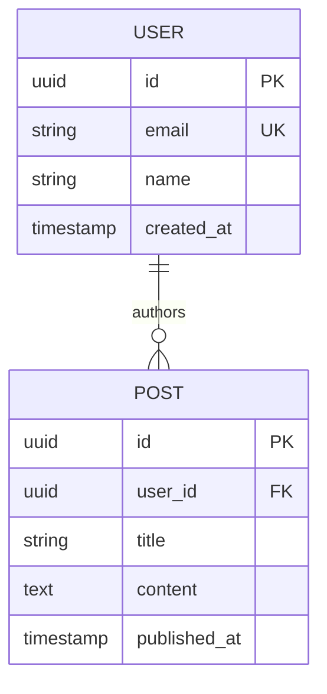

# Database & Data Model Documentation Guide

## Overview

Database documentation (`DATABASE.md`) captures data schemas, table definitions, relationships, indexes, and migration procedures. It guarantees that developers understand how data is organized, queried, and persisted.

---

## 1. Core Database Sections

1. **Database Technology**: Engine (PostgreSQL, MySQL, SQLite, MongoDB), version, and ORM/driver used.
2. **Entity-Relationship Diagram (ERD)**: Visual representation in Mermaid (`erDiagram`).
3. **Table / Collection Definitions**:
   - Column / field name
   - Data type
   - Constraints (PK, FK, Unique, Not Null, Default)
   - Description
4. **Indexes**: Unique and non-unique composite indexes for query performance.
5. **Migrations**: Migration commands and directory locations.

---

## 2. Mermaid ERD Standard

Use `erDiagram` syntax to map relationships:

---

## 3. Extracting Schemas from ORMs

- **Prisma**: Check `prisma/schema.prisma` for models, `@id`, `@relation`, `@unique`, `@@index`.
- **SQLAlchemy**: Check classes inheriting from `Base`, with `Column`, `ForeignKey`, `relationship`.
- **TypeORM / MikroORM**: Check `@Entity()`, `@PrimaryGeneratedColumn()`, `@Column()`, `@ManyToOne()`.
- **Django**: Check `models.py` for `models.CharField`, `models.ForeignKey`, etc.
- **Raw SQL**: Check migration files in `migrations/` or `db/` for `CREATE TABLE` and `CREATE INDEX`.
