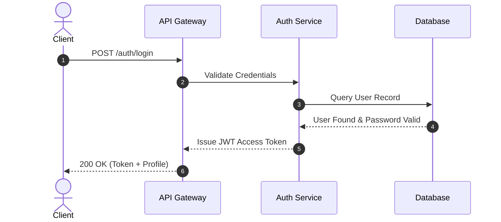
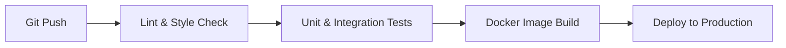

# Mermaid Diagramming Guidelines

## Overview

Mermaid diagrams provide visual representations of architectures, workflows, state transitions, and schemas directly in Markdown. To ensure diagrams render reliably across GitHub, IDEs, and documentation platforms, follow these guidelines.

---

## 1. Supported Diagram Types

| Type | Syntax Declaration | Typical Use Case |
| :--- | :--- | :--- |
| **Flowchart** | `flowchart TD` or `flowchart LR` | Step-by-step processes, CI/CD pipelines, component dependencies |
| **Sequence Diagram** | `sequenceDiagram` | Request-response flows, authentication handshakes, multi-service interactions |
| **Class Diagram** | `classDiagram` | Object-oriented class relationships, inheritance, interfaces |
| **Entity-Relationship** | `erDiagram` | Database schemas, table relations, foreign keys |
| **State Diagram** | `stateDiagram-v2` | State machines, order lifecycle, connection status |

---

## 2. Formatting & Syntax Rules

1. **Quote Node Labels with Special Characters**:
   Labels with parentheses, brackets, colons, or commas MUST be wrapped in double quotes:
   - Correct: `nodeA["Service A (v1.2)"]`
   - Incorrect: `nodeA[Service A (v1.2)]` (triggers syntax errors)
2. **Avoid HTML Tags in Labels**:
   Do not use ` ` or `<b>` inside node labels; use clean text or markdown-safe newlines where supported.
3. **Keep Diagrams Readable**:
   - Limit flowcharts to 15-20 nodes per diagram. If larger, decompose into multiple focused diagrams.
   - Use clear node IDs: `API`, `DB`, `AUTH` rather than arbitrary letters like `A1`, `B2`.
4. **Choose the Right Direction**:
   - Top-to-bottom (`flowchart TD`) for hierarchical pipelines and lifecycles.
   - Left-to-right (`flowchart LR`) for data streams and sequential stages.

---

## 3. Practical Examples

### Sequence Diagram

### Flowchart

