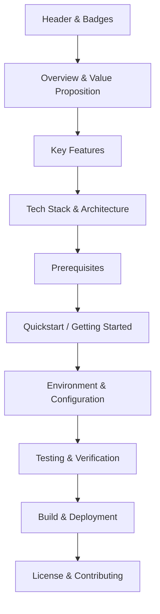

# Production README Guidelines

## Overview

The `README.md` is the primary front door of any software repository. It serves developers, operators, security auditors, and product stakeholders. A production-grade README must be immediately informative, reproducible, and accurate.

---

## 1. Essential README Sections

A complete README should incorporate the following sections:

### 1. Header & Badges
- Project Title with a 1-sentence elevator pitch.
- Badges showing build status, test coverage, package version, license, and primary language.

### 2. Overview & Key Features
- High-level explanation of what problem the project solves.
- Bulleted list of 4-6 primary features.

### 3. Architecture & Tech Stack
- Summary table or Mermaid diagram illustrating high-level architecture.
- Technologies used (Language, Framework, Database, Message Queue).

### 4. Prerequisites
- Specific versions of runtime tools (e.g. Node.js >= 18.0.0, Python >= 3.10, Docker, PostgreSQL 15).
- Derived directly from `package.json` (`engines`), `.python-version`, or Dockerfiles.

### 5. Quickstart
- Copy-paste runnable commands to get the system up and running:
  1. Clone repository
  2. Install dependencies
  3. Set up environment variables
  4. Run database migrations / seed data
  5. Start development server

### 6. Configuration & Environment Variables
- Exhaustive table of environment variables:
  - Variable Name
  - Type
  - Default Value
  - Required (Yes/No)
  - Description

### 7. Available Scripts & Testing
- Documented npm/pip/cargo scripts (e.g., `test`, `lint`, `build`, `dev`).

### 8. Contributing & License
- Link to `CONTRIBUTING.md` and `LICENSE`.

---

## 2. README Quality Criteria

- **Reproducibility**: A developer with the prerequisites should be able to follow the Quickstart and have the system working on their machine without guessing hidden steps.
- **Freshness**: All command names must match scripts defined in `package.json`, `Makefile`, or `pyproject.toml`.
- **Formatting**: Valid Markdown syntax, valid anchors, and no broken links.
